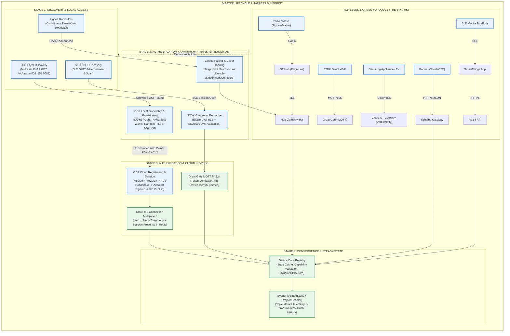
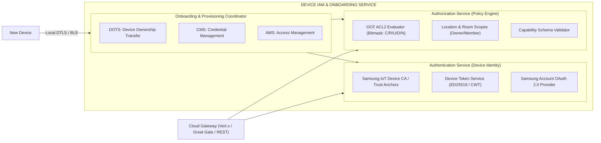
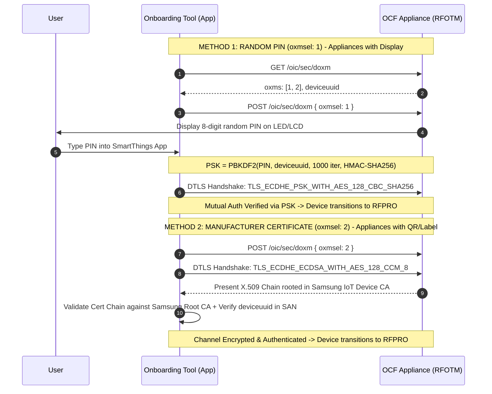
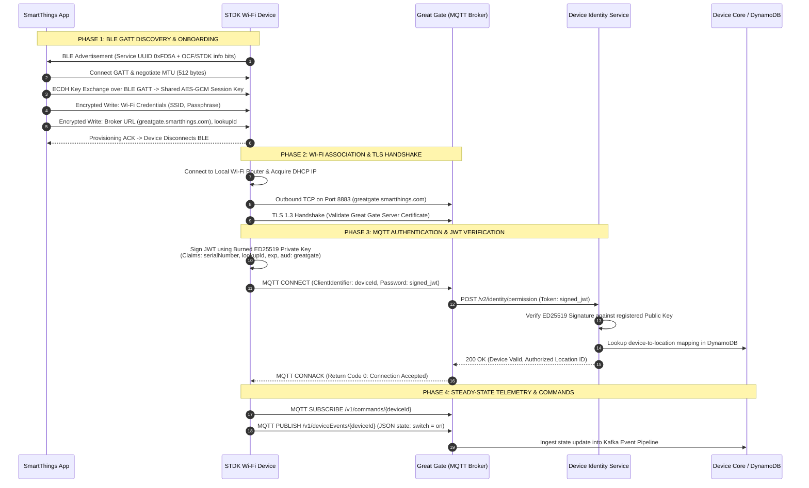
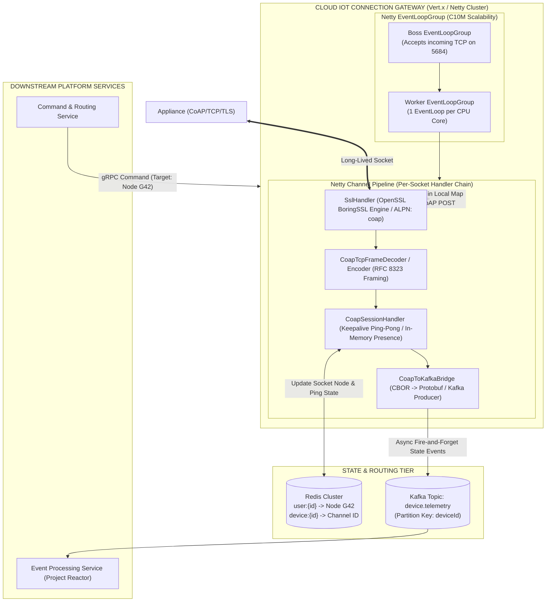

# SmartThings Device Connection & Onboarding Architecture Specification
*High-Level Design (HLD) & Technical Architecture Field Guide*

---

## 1. Executive Summary & Blueprint: The Master Architecture

The SmartThings platform ecosystem accommodates diverse device classes—ranging from ultra-low-power Zigbee/Matter sensors to high-throughput Samsung smart appliances, Wi-Fi microcontrollers (STDK), and third-party cloud integrations. While devices enter through distinct protocol gateways, **all devices converge into a unified data model** (`Device Core`) structured around **Locations**, **Components**, and **Capabilities**.

### 1.1 The Master Blueprint: How All Ingress & Onboarding Flows Connect

Below is the parent blueprint mapping how each device category, discovery method, and onboarding track traverses authentication and authorization to converge on **Device Core**:



---

## 2. Recommended Document Sequencing & Structure

In the original Excalidraw canvas, diagrams are arranged in an ad-hoc order (Path Overview → Zigbee Pairing → OCF Onboarding → OCF Cloud Reg → OCF Discovery). 

To build a professional, publication-grade HLD with a dedicated focus on **Onboarding, Authentication, and Authorization (AuthN/AuthZ)**, structure your document into the following 7 sequential chapters:

```
├── Chapter 1: Global Ingress Topology (The 5 Paths to One Device Record)
│   ├── The 5 Integration Paths
│   └── The Unified Core Data Model (Locations, Components, Capabilities)
│
├── Chapter 2: Onboarding & AuthN/AuthZ Subsystem Architecture (Device IAM)
│   ├── Cryptographic Trust Models (CAs, ECDH, PSK, ED25519)
│   ├── Identity Provisioning & Security Virtual Resources (SVRs)
│   └── Authorization Policy Engine (OCF ACL2 & Location RBAC)
│
├── Chapter 3: Direct-Connected OCF Lifecycle
│   ├── Stage 3.1: Local Discovery & Introspection
│   ├── Stage 3.2: Production Ownership Transfer (Random PIN & Manufacturer Cert)
│   └── Stage 3.3: Cloud Session Ingress & Resource Directory Publishing
│
├── Chapter 4: Direct-Connected STDK Lifecycle (Wi-Fi Microcontrollers)
│   ├── BLE GATT Onboarding & Wi-Fi Provisioning
│   ├── ED25519 JWT Authentication & Great Gate MQTT Session
│   └── Telemetry & Command Routing over MQTT
│
├── Chapter 5: Hub-Connected Device Lifecycle (Zigbee / Matter / Z-Wave)
│   ├── Mesh Join & Radio Discovery
│   ├── Fingerprint Resolution & Edge Driver Matching
│   └── Local Zigbee Binding (ZDO/ZCL) & HubCore Sandbox
│
├── Chapter 6: Cloud IoT Connection Multiplexer (Vert.x / Netty Architecture)
│   ├── Non-Blocking EventLoop & Socket Pipeline
│   ├── Session State, Redis Router & Presence Tracking
│   └── Inbound CoAP-to-Kafka Telemetry vs. Outbound gRPC Command Routing
│
└── Chapter 7: Convergence, State Management & Event Pipeline
    ├── Device Core Registry Synchronization
    └── Command Ingress vs. Event Fan-out Pipeline
```

---

## 3. Dedicated Onboarding, Authentication & Authorization Service (Device IAM)

The **Device Identity and Access Management (Device IAM)** architecture decouples into three cooperating modules:



### 3.1 Authentication (AuthN) Mechanisms by Integration Class

| Device Path | AuthN Credential | Handshake / Transport | Identity Store | Token Lifecycle |
|---|---|---|---|---|
| **OCF Appliances** | Manufacturer X.509 Cert (secp256r1) + Derived Owner PSK | DTLS 1.2 (Local) / TLS 1.3 over TCP (Cloud) | OCF Secure Virtual Resources (`/oic/sec/cred`) | Session ticket + Refresh Token via `/oic/sec/tokenrefresh` |
| **STDK MQTT** | ED25519 Private Key (factory burned) + Serial Number | TLS 1.3 + Signed JWT/CWT sent on MQTT `CONNECT` | Device Identity Service (`/v2/identity/permission`) | JWT valid for 24h; validated against DynamoDB location mapping |
| **Zigbee/Matter Hub** | Install Code / Zigbee Link Key (AES-128); Matter DAC (Device Attestation Cert) | Radio Pairing (802.15.4 / PASE / CASE) | HubCore Local Trust Store & Matter DCL (Distributed Compliance Ledger) | Radio session key negotiated locally; Hub authenticates to cloud via mTLS |
| **Cloud-to-Cloud** | Partner OAuth 2.0 Client Credentials & Bearer Tokens | HTTPS Mutual TLS / REST Webhooks | Cassandra OAuth Token Cluster (replicated across 3 regions) | 24-hour access tokens with background refresh tokens |

---

### 3.2 Production Baseline OCF Ownership Transfer Methods (OTMs)

While **Just Works** (`oxmsel: 0`) is used for quick pairing, production smart appliances require cryptographic protection against Man-in-the-Middle (MITM) attacks.



#### Comparison of Ownership Transfer Methods

| Feature | Just Works (`oxmsel: 0`) | Random PIN (`oxmsel: 1`) [Production] | Manufacturer Cert (`oxmsel: 2`) [Production] |
|---|---|---|---|
| **Cipher Suite** | `TLS_ECDH_ANON_WITH_AES_128_CBC_SHA256` (`0xFF00`) | `TLS_ECDHE_PSK_WITH_AES_128_CBC_SHA256` | `TLS_ECDHE_ECDSA_WITH_AES_128_CCM_8` |
| **MITM Protection**| ❌ No (anonymous key exchange) | ✅ Yes (out-of-band PIN verification) | ✅ Yes (cryptographic trust chain) |
| **Hardware Reqs** | None (headless devices) | Display screen (TV, Fridge, Range) | Secure Element / factory-flashed X.509 cert |
| **Key Derivation** | TLS Master Secret | $\text{PBKDF2}(\text{PIN}, \text{deviceuuid}, 1000, \text{SHA256})$ | Ephemeral ECDH over secp256r1 + ECDSA Signature |
| **Target Products** | Low-cost sensors / prototypes | Family Hub, Samsung Smart TVs, Washers | SmartThings Station, high-security appliances |

---

### 3.3 Authorization (AuthZ) & Access Control Specification

Authorization in SmartThings operates at two layers: **Device-Level (OCF ACL2)** and **Platform-Level (Capability & Location RBAC)**.

#### 1. Device-Level OCF Access Control Entries (SVR `/oic/sec/acl2`)
Every OCF resource on the device is guarded by an Access Control Entry (ACE) stored in the device's secure storage:
- **Permission Bitmask**:
  - `CREATE (C) = 1`
  - `RETRIEVE (R) = 2`
  - `UPDATE (U) = 4`
  - `DELETE (D) = 8`
  - `NOTIFY (N) = 16`
- **Standard Cloud ACE**: To allow the SmartThings cloud to read state, forward commands, and receive observe notifications, the Onboarding Tool writes an ACE with `permission = 22` (`R=2 + U=4 + N=16`) targeted to the cloud's UUID (`sid`):
```json
{
  "aclist2": [
    {
      "aceid": 1,
      "subject": { "uuid": "c0a80101-0000-0000-0000-000000000001" },
      "resources": [
        { "href": "/switch/0" },
        { "href": "/temperature/0" },
        { "href": "/oic/d" },
        { "href": "/oic/p" }
      ],
      "permission": 22
    }
  ]
}
```

#### 2. Platform-Level Capability Validation
When a command is received at `POST /v1/devices/{deviceId}/commands`:
1. **Scope Check**: Bearer token must hold `w:devices:*` or `w:devices:{deviceId}`.
2. **Location Membership**: User/App must belong to the device's `locationId` with appropriate role (`OWNER` or `MEMBER`).
3. **Component/Capability Schema Verification**: Device Core verifies that the target component (e.g., `main`) implements the capability (e.g., `switch`) and that arguments match the capability's JSON Schema.

---

## 4. Comprehensive Analysis of the 5 Base Diagrams

---

### Diagram 1: Top-Level Ingress Topology (The 5 Paths to One Device Record)

#### 1. Purpose & Core Presentation
This diagram presents the **multi-protocol ingress architecture** of the SmartThings platform. Because IoT devices run on incompatible physical layers and protocols (Zigbee mesh, low-cost Wi-Fi microcontrollers, high-end appliance TCP stacks, proprietary third-party clouds, and mobile BLE peripherals), SmartThings does not attempt to force all hardware through a single gateway. Instead, it provides **protocol-specialized ingress gateways** that normalize every device into an identical representation in **Device Core**.

#### 2. Architectural Participants
- **Devices**: Zigbee/Z-Wave/Matter hardware, STDK Wi-Fi chips, Samsung OCF Appliances/TVs, Partner Clouds, and Mobile BLE Tags.
- **Local Agents**: The SmartThings Hub (running Lua Edge drivers) and Galaxy Phones (running the SmartThings App).
- **Cloud Ingress Gateways**:
  - **Hub Connection Tier** (`*.connect.smartthings.com`): Handles persistent bi-directional links with physical hubs.
  - **Great Gate**: High-scale MQTT broker terminating TLS for direct Wi-Fi STDK microcontrollers.
  - **OCF Cloud Endpoint / IoT Gateway**: Terminates CoAP-over-TCP/TLS connections for Samsung appliances.
  - **Schema Gateway** (`c2c-{region}.smartthings.com`): Communicates with third-party partner clouds.
  - **REST API** (`api.smartthings.com/v1`): Ingress for mobile devices, webhooks, and third-party apps.
- **Device Core & Event Pipeline**: The platform center of gravity that stores state and emits state changes.

#### 3. Step-by-Step Flow & Protocol Mechanics
1. **Mesh Devices**: Communicate over 802.15.4/Z-Wave/Thread radios to a local SmartThings Hub. The Hub's Lua Edge driver parses raw frames, validates capability schemas, and forwards events over an encrypted persistent TLS link to the **Hub Connection Tier**.
2. **STDK Devices**: Open an outbound TLS connection directly to **Great Gate** on port 8883. Authenticate using an ED25519-signed JWT containing device serial and public key.
3. **Samsung Appliances**: Establish a long-lived CoAP-over-TCP/TLS session to the **Cloud IoT Gateway**, publishing their resources under `/oic/rd`.
4. **Partner Clouds**: Exchange state changes and commands with the **Schema Gateway** using HTTPS JSON REST payloads and OAuth 2.0 bearer tokens.
5. **BLE Mobile Devices**: Connect via BLE to the user's Galaxy smartphone. The SmartThings app acts as the gateway, calling the **REST API** over HTTPS.
6. **Convergence**: All 5 gateways map their incoming protocol payloads into normalized SmartThings Events (`{ deviceId, component, capability, attribute, value }`) and write them to **Device Core**, which forwards them onto the **Kafka Event Pipeline**.

---

### Diagram 5: OCF Discovery on Local Network

#### 1. Purpose & Core Presentation
This diagram illustrates **Phase 1 of OCF device onboarding**: how the SmartThings app (or Onboarding Tool / OBT) discovers unconfigured or configured OCF devices residing on the local Wi-Fi/Ethernet network without knowing their IP addresses in advance.

#### 2. Architectural Participants
- **Client**: The SmartThings mobile app acting as the OCF Onboarding Tool (OBT).
- **Multicast Group**: IPv6 multicast group `ff02::158` on UDP port `5683` (OCF All-Nodes Multicast).
- **OCF Device**: A smart appliance or TV acting as an OCF Server.

#### 3. Step-by-Step Walkthrough
- **Step 1 (`GET /oic/res?rt=...`)**: The Client sends a CoAP Non-Confirmable (`NON`) multicast `GET` request to `ff02::158` on port 5683. It filters for specific resource types (e.g., `?rt=oic.r.switch.binary`) or queries unowned devices via `GET /oic/sec/doxm?owned=FALSE`.
- **Step 2 (Delivery)**: The local Wi-Fi router / switch replicates the multicast packet to all network nodes listening on the OCF multicast address.
- **Step 3 (`2.05 Content`)**: Matching devices respond via **unicast UDP** with a CoAP `2.05 Content` payload containing a CBOR array of links (`links[]`). Each link exposes an `anchor` (`ocf://<di>`), `href` (resource URI), `rt` (resource type), `if` (interfaces), and `eps` (endpoint IP and port).
- **Step 4 (`GET /oic/d` and `/oic/p`)**: The Client initiates targeted unicast requests to the device's specific IP and port to retrieve the logical Device Identity (`/oic/d`) and Platform Identity (`/oic/p`).
- **Step 5 (Identity Metadata Response)**: The device returns its unique device UUID (`di`), spec version (`icv`), manufacturer name (`mnmn`), model number (`mnmo`), and vendor ID (`vid`). In SmartThings, this `vid` becomes the `presentationId` that dictates UI rendering.
- **Step 6 & 7 (`GET introspection URL`)**: The Client fetches the OpenAPI 2.0 Swagger specification (encoded in CBOR) directly from the device's introspection endpoint. This tells the Client every custom resource and payload schema the device supports.

---

### Diagram 3: OCF Local Onboarding & Ownership Transfer (Just Works)

#### 1. Purpose & Core Presentation
This diagram depicts **Phase 2 of OCF Onboarding**: transitioning an unowned device from an insecure factory state into an owned, encrypted, and operational state (**RFOTM → RFPRO → RFNOP**). It establishes cryptographic ownership using the **Just Works** method.

#### 2. Key Concepts & Provisioning State Machine
- **RFOTM (Ready for Ownership Transfer Method)**: Device is in factory-default unowned state. Only ownership endpoints are exposed.
- **RFPRO (Ready for Provisioning)**: Ownership established; credentials and access rules are being written.
- **RFNOP (Ready for Normal Operation)**: Device is fully provisioned, locked, and operational (`isop = true`).

#### 3. Step-by-Step Walkthrough
- **Phase A: Unsecured Negotiation (RFOTM)**
  - **Steps 1-2**: The Onboarding Tool (OBT) queries `/oic/sec/doxm` (Device Ownership Transfer Model). The device returns supported methods (`oxms: [0, 1, 2]`) and its permanent UUID (`deviceuuid`).
  - **Step 3**: The OBT selects **Just Works** (`oxmsel: 0`).
- **Phase B: Anonymous DTLS & Ownership Claim**
  - **Step 4**: OBT and Device execute a DTLS handshake using the anonymous cipher suite `TLS_ECDH_ANON_WITH_AES_128_CBC_SHA256` (`0xFF00`). This secures the channel against passive eavesdropping.
  - **Steps 5-6**: OBT writes to `/oic/sec/pstat` (Provisioning Status) and writes its own UUID into `/oic/sec/doxm` as the official owner (`devowneruuid`, `rowneruuid`).
  - **Steps 7-8**: OBT provisions security policies: writes initial Access Control Lists to `/oic/sec/acl2` and pushes credential descriptors to `/oic/sec/cred`.
  - **Step 9**: The device derives an **Owner Pre-Shared Key (PSK)** from the TLS master secret and saves it in `privatedata`. OBT sets `/oic/sec/doxm { owned: true }`.
  - **Step 10**: Device updates state in `/oic/sec/pstat` to `dos.s: 2` (**RFPRO**). The temporary anonymous DTLS session is closed.
- **Phase C: Authenticated DTLS Session & Lock (RFNOP)**
  - **Step 11**: OBT opens a **new DTLS session** using the authenticated cipher suite `TLS_ECDHE_PSK_WITH_AES_128_CBC_SHA256` powered by the newly minted Owner PSK.
  - **Step 12**: With mutual authentication established, OBT writes final operational ACL rules and sets `/oic/sec/pstat { dos.s: 3 }` (**RFNOP**). The device is now securely paired.

---

### Diagram 4: OCF Cloud Registration (Provision, Sign-Up, Sign-In, Publish)

#### 1. Purpose & Core Presentation
This diagram presents **Phase 3 of OCF device integration**: how a locally onboarded device is joined to the SmartThings Cloud. It demonstrates how a **Mediator** (the mobile app) acts as a trust bridge to provision cloud credentials to the device, allowing the device to maintain its own long-lived connection to the cloud.

#### 2. Architectural Participants
- **Mediator**: The SmartThings mobile app.
- **Auth Provider**: Samsung Account OAuth 2.0 authorization server.
- **OCF Cloud**: Cloud IoT Gateway and Resource Directory (`/oic/rd`).
- **OCF Device**: The physical appliance (already owned locally).

#### 3. Step-by-Step Walkthrough
- **Phase 1: Mediator Sign-In & Delegation**
  - **Steps 1-2**: The app completes an OAuth 2.0 authorization code flow with the Samsung Account service and receives an access token.
  - **Steps 3-4**: The app calls the OCF Cloud to register the device's `di` (Device ID) under the user's account and requests a **one-time device authorization code / token (`at`)**.
- **Phase 2: Mediator Provisions Device over Local DTLS**
  - **Step 5**: The app talks to the device over the secure local DTLS channel and updates the resource `/oic/r/coapcloudconf`:
    - `cis`: OCF Cloud address (`coaps+tcp://...`)
    - `sid`: Cloud UUID
    - `at`: One-time access token / authorization code
    - `apn`: Authorization provider name ("samsung")
    - Device state shifts to `cps: readytoregister`.
- **Phase 3: Device Connects Direct to OCF Cloud**
  - **Step 6**: The device opens an outbound TCP connection to the cloud endpoint and negotiates TLS using its factory-burned manufacturer certificate and ALPN.
  - **Steps 7-8 (`/oic/sec/account`)**: Device sends a CoAP `POST` to `/oic/sec/account` with its `di` and the one-time token `at`. The cloud registers the device, returning a permanent user ID (`uid`), device access token, and refresh token.
  - **Steps 9-10 (`/oic/sec/session`)**: Device initiates a session by posting to `/oic/sec/session` (`login: true`). The cloud confirms the active session.
  - **Steps 11-12 (`/oic/rd` Publish & Observe)**: Device publishes all its observable application resources (`/switch/0`, `/temperature/0`, `/oic/d`, `/oic/p`) to the Cloud Resource Directory. The cloud issues a CoAP `GET` with the **Observe** option (RFC 7641) to subscribe to real-time state changes.
- **Steady State (Step 13)**: The device maintains the TCP connection using application-layer CoAP Ping/Pong and automatically refreshes tokens via `POST /oic/sec/tokenrefresh` before expiry.

---

### Diagram 2: Hub-Connected Device Pairing (Zigbee via Edge Driver)

#### 1. Purpose & Core Presentation
This diagram presents the **Hub-connected onboarding flow** for local mesh radio devices (Zigbee, Z-Wave, Matter). Unlike Wi-Fi and OCF devices, constrained Zigbee devices have no TCP/IP stack. Instead, pairing and protocol translation are delegated to **SmartThings Edge drivers** written in Lua running locally on the SmartThings Hub.

#### 2. Architectural Participants
- **App**: SmartThings mobile app UI.
- **Cloud**: SmartThings Cloud Driver & Device Services.
- **Hub (HubCore)**: Local hub daemon written in Rust and C that controls radio hardware.
- **Edge Driver**: Sandboxed Lua runtime environment executing device logic on the hub.
- **Zigbee Device**: Physical 802.15.4 mesh device (e.g., smart plug, door sensor).

#### 3. Step-by-Step Walkthrough
- **Steps 1-2 (Network Join Window)**: User selects "Add device" in the app. The cloud commands HubCore to open the Zigbee coordinator network for joining (permit-join broadcast for 60 seconds).
- **Step 3 (Radio Announcement)**: The physical Zigbee device powers on, associates with the hub mesh, and sends a `Device_annce` ZDO message.
- **Step 4 (Descriptor Discovery)**: HubCore reads the device's Basic cluster, endpoints, and input/output clusters over the air.
- **Step 5 (Fingerprint Upload)**: HubCore sends the collected hardware identifiers (Manufacturer Code, Model Identifier, Application Version, Cluster IDs) to the Cloud Device Service.
- **Note (Matching Engine)**: The cloud evaluates the fingerprint against available driver packages:
  1. Exact manufacturer + model match in `fingerprints.yaml` always wins.
  2. Generic cluster matches (e.g., standard On/Off Zigbee switch) act as fallbacks.
- **Step 6 (Driver Installation)**: Cloud instructs the hub to download/assign the selected Edge driver and creates the canonical device record in the cloud database.
- **Step 7 (Driver Lifecycle)**: HubCore instantiates the Lua driver and invokes its lifecycle callbacks in strict sequence:
  `added` (first-time creation) → `init` (driver startup) → `doConfigure` (hardware configuration).
- **Step 8 (ZDO Bind & Reporting Configuration)**: Inside `doConfigure`, the Lua driver issues Zigbee Device Object (ZDO) bind requests and ZCL `ConfigureReporting` frames to tell the device how frequently to report attribute changes.
- **Steps 9-11 (Initial State & Tile Update)**: The Zigbee device reports its initial state (e.g., `On/Off = 1`). The Edge driver converts this into a capability event:
  `device:emit_event(capabilities.switch.switch.on())`.
  HubCore streams this to the cloud, updating the device state cache and reflecting immediately on the mobile app tile.

---

## 5. Direct-Connected STDK Device Lifecycle (BLE GATT & Great Gate MQTT)

Third-party Wi-Fi devices built with the **SmartThings Device SDK (STDK)** (such as ESP32, Realtek Ameba, or Beken chips) do not implement OCF. They execute a lightweight C SDK that communicates via BLE during onboarding and connects to **Great Gate** over MQTT in steady-state.

### 5.1 End-to-End STDK Onboarding & MQTT Connect Flow



### 5.2 Key Security Controls for STDK Devices
- **Key Generation**: At manufacturing time, the vendor runs `stdk-keygen.py` to create an **ED25519** keypair and serial number. The public key is registered in the SmartThings Console; the private key is flashed into the MCU's secure storage / eFuse.
- **Factory Reset Guarantee**: If a device connects to Great Gate but the user has deleted the device from the app, Great Gate returns `lookupId not found`. The STDK firmware must immediately wipe Wi-Fi credentials and drop into unprovisioned BLE mode.

---

## 6. Cloud IoT Gateway: Vert.x / Netty Connection Multiplexer

For Samsung appliances and TVs connecting over CoAP-over-TCP/TLS, the backend terminates millions of long-lived TCP connections. As introduced in [`HLD.excalidraw`](file:///c:/Users/kanis_5g38ios/Projects/HLD/SmartThings/HLD.excalidraw), this gateway uses a **Vert.x / Netty EventLoop architecture** to achieve high concurrency with low memory footprint.

### 6.1 Gateway Component & Pipeline Architecture



### 6.2 Key Operational Specifications of the Netty Gateway
1. **Socket Framing (RFC 8323)**: Unlike UDP CoAP, CoAP-over-TCP prepends each message with a length field (2-byte or 4-byte header). The `CoapTcpFrameDecoder` aggregates frames and emits complete CoAP messages without blocking the event loop.
2. **Presence & Heartbeat**: Devices send application-level CoAP Pings (`Code 7.02`) every 120 seconds. The `CoapSessionHandler` answers with Pong (`Code 7.03`). If two consecutive pings are missed (240s), the gateway closes the socket and publishes an `OFFLINE` status event to Kafka.
3. **Connection Router (Redis Map)**: 
   - When a device authenticates, the gateway records `device:{deviceId} -> {nodeIp: "10.0.4.42", channelId: "0xfa12"}` in Redis with a TTL of 300 seconds.
   - When the **Command & Routing Service** receives `POST /v1/devices/{id}/commands`, it queries Redis, resolves the gateway node IP, and invokes a gRPC call: `ForwardCommand(deviceId, payload)`.
   - The target Netty node fetches the channel from its local concurrent channel map and writes the CoAP `POST` directly to the socket.

---

## 7. Architectural Comparison Matrix

| Feature | OCF Direct-Connected (Diag 5, 3, 4) | Hub Edge Zigbee (Diag 2) | STDK MQTT Wi-Fi (Section 5) | Cloud-to-Cloud Schema |
|---|---|---|---|---|
| **Physical Transport** | Wi-Fi / Ethernet (IPv6 Mandatory) | 802.15.4 Radio Mesh | Wi-Fi (IPv4 / IPv6) | Internet HTTPS |
| **Session Protocol** | CoAP over TCP + TLS 1.3 | Zigbee ZCL / HubCore TLS | MQTT 3.1.1 over TLS 1.3 | HTTPS REST Webhooks |
| **Ingress Gateway** | Vert.x / Netty Connection Server | Hub Gateway Tier (`*.connect`) | Great Gate MQTT Broker | Schema Gateway (`c2c-{region}`) |
| **Onboarding Channel** | Local Multicast UDP + DTLS | Radio Permit-Join Beacon | BLE GATT (v2.0) | Web OAuth 2.0 Redirect |
| **Trust Establishment** | SVR Ownership (`doxm`), Random PIN / Mfg Cert | Zigbee Link Key / Install Code | ED25519 Keypair (Factory Flashed) | OAuth Client ID & Secret |
| **Device Logic Location**| On-device firmware (IoTivity) | Lua Edge Driver on Local Hub | On-device C SDK (STDK) | Partner Cloud Infrastructure |
| **Local Offline Execution**| Peer-to-peer OCF (Local network) | Hub Hive Engine (Full offline) | Cloud-dependent (Great Gate) | Cloud-dependent |
| **State Machine** | `RESET` → `RFOTM` → `RFPRO` → `RFNOP` | `added` → `init` → `doConfigure` | `BOOT` → `BLE_PROV` → `MQTT_CONN` | `Discovery` → `GrantCallback` |
